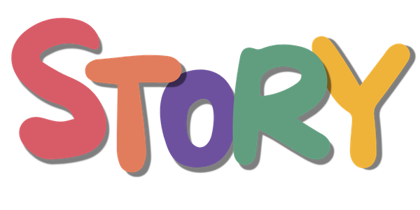
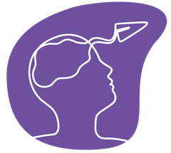

<p align="center">
  
</p>

<p align="center">
  <b>Illness <ins>S</ins>tages, Progression, and Recovery <ins>T</ins>rajectories <ins>o</ins>f Eating Diso<ins>r</ins>ders in <ins>Y</ins>oung People</b><br>
  Code repository
</p>

<p align="center">
  <a href="https://edifyresearch.co.uk"></a>
  <a href="#data-access"></a>
  <a href="https://github.com/RADAR-base"></a>
  
  <a href="https://doi.org/10.1186/s12888-024-05841-w"></a>
  
</p>

<p align="center">
  <picture>
    <source media="(prefers-color-scheme: dark)" srcset="assets/people-linework-light.png">
    
  </picture>
</p>

## About the study



STORY is a UK-wide, multi-centre prospective cohort study of eating disorders in young people aged 16-25. It recruited over 1,000 participants with a current eating disorder alongside healthy controls.

STORY was designed to delineate the heterogeneity of early- and later-stage illness, identify recovery pathways and establish biopsychosocial markers of improvement and relapse. To do this, STORY integrated comprehensive biopsychosocial assessments with one year of continuous remote monitoring using Remote Measurement Technology (RMT), encompassing smartphone-based active assessments, as well as with passive sensing from smartphones and wearable devices (Ōura smart rings). Smartphone data were collected with the open-source [RADAR-base](https://github.com/RADAR-base) platform. Data collection is ongoing. Full details of the study design are in the [published protocol](https://doi.org/10.1186/s12888-024-05841-w).

STORY is part of [EDIFY](https://edifyresearch.co.uk), a research programme bringing together the arts, humanities and sciences to map young people's routes into and out of eating disorders. It combines EDIFY's workstreams 3 (Recovery) and 4 (Illness Stages and Progression).

## About this repository


This repository contains the code used to process, clean and analyse STORY study data. It does **not** contain any participant data. Scripts are organised by data type.

The repository is under active development. Not all folders listed below are complete, placeholders are included for transparency about the full scope of planned analyses.

## Repository structure
```
STORY-study/
│
├── README.md                        
├── assets/                          # logos and images
│
├── data-pipeline/                   # Cleaning, preprocessing and analysis of baseline and follow-up questionnaire data (REDCap) (tbc)
│
├── rmt-pipelines/         
│   ├── README.md                    
│   ├── STORY_prelim_analysis.ipynb  # Preprocessing and preliminary machine learning analysis predicting
│   │                                    # eating disorder outcomes from fortnightly wearable windows
│   ├── rmt-active/                  # Active RMT processing and analysis (e.g., ecological momentary assessments) (tbc)
│   ├── rmt-passive-phone/           # Passive RMT processing and analysis (phone sensor data) (tbc)
│   └── rmt-passive-oura/            # Passive RMT processing and analysis (wearable data) (tbc)
│
├── cognitive/                       # Cognitive lab-based tasks and eye-tracking (tbc)
│
├── neuroimaging/                    # Neuroimaging data (tbc)
│
└── qualitative/                     # Qualitative interview data (tbc)
```

## Data access
The STORY dataset is not publicly available at this time, but will be made available through a managed access process in the future. If you are interested in accessing the data for research purposes, please contact the research team at [story@kcl.ac.uk](mailto:story@kcl.ac.uk) or the principal investigator, Professor Ulrike Schmidt ([ulrike.schmidt@kcl.ac.uk](mailto:ulrike.schmidt@kcl.ac.uk)).

## Citation
If you use any code from this repository, please cite this repository and the STORY study protocol:

> Kuehne C, Phillips MD, Moody S, et al. Characterising illness stages and recovery trajectories of eating disorders in young people via remote measurement technology (STORY): a multi-centre prospective cohort study protocol. *BMC Psychiatry*. 2024;24:409. https://doi.org/10.1186/s12888-024-05841-w

> Kuehne C, Bryson C, Lopes M, İnce B, Tatham R, et al. Characterising illness stages and recovery trajectories of eating disorders in young people via remote measurement technology (STORY): recruitment and cohort profile of a multi-centre prospective study. <i>(under review; updated on publication)</i>.

## Support


If you are affected by an eating disorder, [Beat](https://www.beateatingdisorders.org.uk), the UK's eating disorder charity, offers support and helplines. EDIFY also lists [resources for young people, families and professionals](https://edifyresearch.co.uk/resources).

## Funding
This work is supported by the Medical Research Council, Arts and Humanities Research Council, and Economic and Social Research Council Adolescence, Mental Health and the Developing Mind initiative, as part of the EDIFY programme (grant number MR/W002418/1).

<p align="center">
  
</p>
